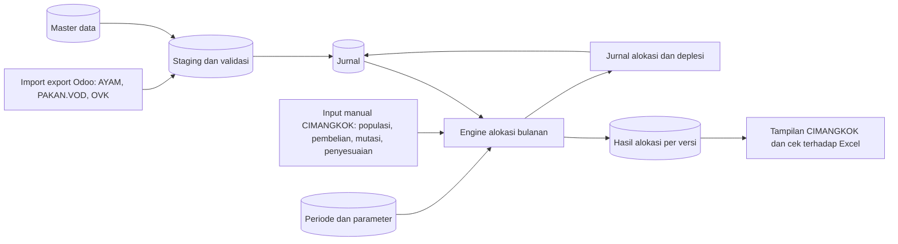

# PRD: Sistem Jurnal & Alokasi Biaya Ayam

**Phase 1: dari sheet input sampai sheet CIMANGKOK**

| | |
|---|---|
| Status | Draft v0.3, 20 Oktober 2026 |
| Stack | Laravel (API), React + TypeScript (tampilan), Supabase (database sementara) |
| Sumber | `konsep_alokasi_biaya.xlsx`, `flowchart-draft.drawio`, `Table Sistem Ayam.txt` |

---

## Ringkasan Singkat

**Yang dibangun:** sistem yang mengubah data export Odoo (yang sekarang diolah di Excel) menjadi jurnal, lalu menghitung alokasi biaya per kandang seperti di sheet CIMANGKOK.

**Odoo tidak diganti.** Odoo tetap jadi sumber data. Sistem ini hanya lapisan jurnal dan alokasi di atasnya.

**Hasil akhir Phase 1:**
1. Data 3 sheet input (AYAM, PAKAN.VOD, OVK) bisa di-import dan menjadi jurnal.
2. Bagian yang di Excel diketik manual (populasi, pembelian, mutasi, penyesuaian) bisa diinput di sistem.
3. Alokasi biaya CIMANGKOK dihitung otomatis dan hasilnya masuk ke jurnal.
4. Angka hasilnya sama dengan Excel (lihat Bagian 7).

**Belum termasuk:** farm lain (CARIU, GEKBRONG, TALUN), broiler (KOMERSIL), sheet REKAP, HPP DOC, Buku Besar penuh, dan input transaksi harian penuh.

### Isi dokumen
1. Gambaran Umum
2. Istilah yang Dipakai
3. Master Data
4. Data yang Disimpan
5. Aturan Hitung CIMANGKOK
6. Kebutuhan Fungsional
7. Cara Menguji
8. Catatan Teknis
9. Backlog

---

## 1. Gambaran Umum

### 1.1 Alur kerja

Penjelasan singkat:
1. File export Odoo di-upload, dicek, lalu masuk ke jurnal.
2. Data manual CIMANGKOK diinput di sistem. *bantu crosschek penting enggaknya 
3. Engine membagi biaya bulanan ke tiap kandang, menghitung deplesi dan mutasi, lalu menyimpan hasilnya per versi.
4. Hasil final membuat jurnal alokasi dan bisa dibandingkan dengan sheet CIMANGKOK.

### 1.2 Dikerjakan dan ditunda

**Dikerjakan di Phase 1**
- Import 3 sheet input ke jurnal
- Master data minimal ( Lihat file Table Sistem Ayam.txt )
- Input manual data CIMANGKOK
- Engine alokasi untuk satu farm (CIMANGKOK)
- Tampilan setara sheet CIMANGKOK dan pengecekan terhadap angka Excel

**Ditunda ke Phase 2 dan seterusnya**
- Input transaksi harian penuh dan pembuatan jurnal dari transaksi
- Buku Besar penuh
- Sheet REKAP
- CARIU, GEKBRONG, TALUN
- KOMERSIL (broiler) dan HPP DOC PAJAK
- Data Flock sebagai entitas tersendiri

### 1.3 CIMANGKOK mengambil data dari mana?

Hasil pemeriksaan rumus di sheet CIMANGKOK:

| Sumber | Dipakai untuk | Penanganan di Phase 1 |
|---|---|---|
| `PAKAN.VOD` (48 rumus) | Biaya bulanan: pakan, disinfectant, vaccine, medicines & vitamin | Dihitung dari jurnal hasil import |
| `AYAM` (12 rumus) | Pembelian ayam per bulan | Dihitung dari jurnal hasil import |
| `KOMERSIL` (12 rumus, sel `AC55:AC66`) | Mutasi ke kandang lain per bulan | Sheet KOMERSIL ditunda, jadi nilainya diinput manual atau diambil dari Excel |
| `OVK` | **Tidak dipakai** CIMANGKOK | Tetap di-import ke jurnal, tapi belum dipakai engine |

Sheet yang memakai hasil CIMANGKOK (REKAP dan HPP DOC PAJAK) ditunda.

---

## 2. Istilah yang Dipakai

| Istilah | Artinya |
|---|---|
| **Jurnal** | Catatan akuntansi dengan sisi debit dan kredit yang harus seimbang |
| **SO** | Jumlah ayam (ekor) di awal bulan. Dipakai sebagai dasar pembagian biaya |
| **SA** | Kolom SA di Excel, kemungkinan jumlah ayam di akhir bulan (belum dikonfirmasi) |
| **NBO / NBA** | Saldo awal / saldo akhir. Isinya ekor atau rupiah tergantung kolomnya |
| **Growing** | Ayam masa pertumbuhan |
| **Laying** | Ayam masa produksi telur |
| **DOC** | *Day Old Chick*, anak ayam umur sehari |
| **Biaya bulanan** | Total biaya yang dibagikan ke kandang (pakan, disinfectant, vaccine, medicines & vitamin) |
| **Alokasi** | Pembagian biaya bulanan ke tiap kandang |
| **Deplesi** | Pengurangan nilai ayam laying sedikit demi sedikit tiap bulan |
| **Mutasi** | Perpindahan ayam atau nilainya ke kandang lain |
| **Plug** | Angka koreksi yang diketik manual di Excel |
| **Staging** | Tabel penampung sementara saat import, sebelum masuk jurnal |
| **Idempotent** | Import file yang sama dua kali tidak menggandakan data |
| **Parity** | Hasil sistem sama dengan hasil Excel |

---

## 3. Master Data

Master adalah data acuan yang dipakai berulang. Berikut pemetaan dari daftar master yang sudah lo susun.

| Master | Phase 1 | Catatan |
|---|---|---|
| COA | Ya | Kode berbentuk teks bertingkat, contoh `1-130-9-1`. Perlu diputuskan memakai `1-130-x` (export Odoo) atau `1-131-x` (REKAP) |
| Mapping jurnal | Disederhanakan | Jurnal import sudah jadi dari Odoo. Mapping hanya untuk jurnal hasil engine (alokasi dan deplesi) |
| Jurnal header dan detail | Ya | Ada status (draft, posted, reversed) dan sumber (import atau engine) |
| Customer dan vendor | Ya | Kode unik = nomor NPWP (disimpan hanya angka, tanpa titik dan strip). Cabang tidak dibedakan (lihat catatan di bawah) |
| Ayam | Disederhanakan | Cukup daftar jenis ayam yang terhubung ke akun persediaan (GPS, PS, Broiler, DOC, jantan atau betina). Growing atau laying adalah fase di baris bulanan, bukan master |
| Kandang | Ya | Kode unik per lokasi, contoh `B-CMK/10FL` |
| Lokasi | Ya | Plus daftar alias, contoh `Farm CImangkok` dipetakan ke `Farm Cimangkok` |
*tambahkan yang belum ada seperti di file Table Sistem Ayam.txt *

**Tambahan minimal:** Divisi (GPS dan TIB), Kategori Operasional (pakan, disinfectant, vaccine, medicines & vitamin, overhead), Periode (open atau closed), dan Parameter (contoh: masa deplesi).

**Soal NPWP sebagai kode unik:** kode partner diambil dari NPWP dan cabang tidak dibedakan. Di export Odoo satu NPWP bisa muncul dengan beberapa nama rekanan (di data ada 3 grup NPWP dengan total 9 nama rekanan, misalnya `PT INTERTAMA TRIKENCANA BERSINAR` dengan akhiran CIJANGKAR, CIPANAS, KPA 1, dan TANJUNG). Semua nama itu didaftarkan sebagai alias dari satu partner, jadi saat import tidak membuat partner baru. Rekanan yang tidak punya NPWP perlu aturan tersendiri (lihat pertanyaan 7 di Bagian 5).
*dibuat tetap 1 nama rekanan 1 NPWP meskipun banyak cabang*

---

## 4. Data yang Disimpan

| Kelompok | Tabel | Isi |
|---|---|---|
| Master | `coa`, `divisi`, `lokasi`, `lokasi_alias`, `kandang`, `partner`, `partner_alias`, `kategori_operasional`, `jenis_ayam` | Data acuan (Bagian 3) |
| Periode | `periode`, `parameter_hpp` | Bulan buka atau tutup, dan nilai parameter seperti masa deplesi |
| Import | `import_batch`, `import_row` | File sumber, jumlah baris, status, error per baris |
| Jurnal | `jurnal_header`, `jurnal_detail` | Nomor, tanggal, akun, debit, kredit, lokasi, divisi, kandang, partner |
| Input CIMANGKOK | `populasi_bulanan` | Per bulan dan kandang: fase, strain, umur minggu, SO, SA, mati, jual, koreksi |
| | `input_alokasi` | Pembelian ayam, mutasi, dan penyesuaian, lengkap dengan alasan dan pembuat |
| Hasil | `alokasi_run`, `alokasi_baris` | Hasil hitung per versi (draft atau final), kolom setara CIMANGKOK |
| Sistem | `audit_log` | Siapa mengubah apa dan kapan |
*tambahkan yang belum ada seperti di file Table Sistem Ayam.txt *

**Aturan data**
- Uang memakai `NUMERIC(20,2)`, jumlah ayam memakai bilangan bulat.
- Tidak ada hapus permanen pada jurnal. Koreksi dilakukan dengan jurnal pembalik.
- Zona waktu Asia/Jakarta.

**Kolom di 3 sheet input (sama semuanya):** bulan, FIELD1 (PEMBELIAN, kosong berarti PEMAKAIAN), divisi, lokasi, status, tipe, jenis, kode COA, nama COA, rekanan, label, referensi, nomor, tanggal, debit, kredit, mutasi.

**Hal yang harus ditangani saat import**
- Di sheet AYAM, baris mati/jual berisi **jumlah ekor**, sedangkan baris pembelian berisi **rupiah**, dalam kolom yang sama. Baris mati/jual juga tidak punya lokasi. Keduanya harus dipisah. Mati/jual per kandang tetap diinput di `populasi_bulanan`.
- Nama tidak konsisten: `Farm CImangkok` (1.568 baris), `TALUN 2`, dan `ANUGERAH` vs `ANUGRAH`.
- Kolom `STATUS` kosong: 18 baris di PAKAN.VOD dan 6 baris di OVK (di OVK, lokasi dan bulan juga kosong).

---

## 5. Aturan Hitung CIMANGKOK

Aturan ini dibaca dari rumus Excel, jadi **perlu dikonfirmasi pemilik Excel** sebelum engine dibuat.

| No | Aturan dalam bahasa sederhana | Sel di Excel |
|---|---|---|
| 1 | Biaya bulanan dibagi ke tiap kandang sesuai SO. Rumus: biaya bulan ÷ total SO bulan × SO kandang | `J8` |
| 2 | Biaya bulanan = total pemakaian pakan, disinfectant, vaccine, dan medicines & vitamin dari PAKAN.VOD | `AJ8:AL55`, `AH` |
| 3 | Ada koreksi manual "ALOKASI BIAYA" per bulan (angka diketik, bisa plus atau minus). Koreksi ini hanya masuk ke ayam laying, tidak ke growing | `AL56:AL67`, `J20` |
| 4 | Ayam growing: biaya terkumpul = nilai awal + alokasi bulan ini. Sisa = biaya terkumpul dikurangi mutasi | `O20`, `S20` |
| 5 | Mutasi dibagi ke kandang penerima sesuai SO. Kandang penerima ditentukan manual lewat rentang `SUM` yang berbeda tiap bulan | `R33`, `AN:AP` |
| 6 | Deplesi ayam laying = nilai ÷ 9, tiap bulan. Angka 9 diketik langsung di rumus | `Q33` |
| 7 | Jumlah ayam akhir = awal dikurangi mati, jual, dan koreksi. Hasilnya jadi jumlah awal bulan berikutnya | `N8`, `H24` |
| 8 | Saldo akhir = saldo awal + pembelian + alokasi − deplesi − jual − mutasi | sheet REKAP |

### Prinsip penyesuaian manual
Setiap penyesuaian, termasuk pengganti plug di aturan 3, disimpan sebagai **entri tersendiri** di `input_alokasi` dengan nilai, alasan, user, dan waktu. Penyesuaian tidak menimpa data import dan selalu bisa ditelusuri ke data Odoo.

### Pertanyaan untuk pemilik Excel
1. Dari mana angka koreksi di aturan 3 berasal, dan siapa yang menyetujui?
2. Bagaimana aturan memilih kandang penerima mutasi tiap bulan (aturan 5)?
3. Apa arti persis SO, SA, NBO, NBA? Kolom SA berisi angka pecahan (misalnya 2.792,91), dan sambungan SO antar bulan tidak konsisten (`F40 = H24`, sedangkan `F24 = G8` dan `F56 = G40`).
4. Apakah masa deplesi selalu 9 bulan, atau berbeda per jenis ayam?
5. Kode COA mana yang dipakai: `1-130-x` atau `1-131-x`?
6. Apa arti kode kandang `FL`, `ML`, `(A)`, `(B)`? Kolom "FLOCK NO" di Excel isinya `GPS ROSS` (strain), bukan nomor flock.
7. Bagaimana kode partner untuk rekanan yang tidak punya NPWP, misalnya perorangan?

---

## 6. Kebutuhan Fungsional

Semua kebutuhan di bawah wajib untuk Phase 1.

| No | Kebutuhan | Dianggap selesai jika |
|---|---|---|
| 1 | Kelola master data dan alias lokasi/partner | Kode tidak boleh ganda. Master yang sudah dipakai hanya bisa dinonaktifkan |
| 2 | Upload export Odoo (xlsx atau csv), cek, lalu masuk ke jurnal | Upload ulang tidak menggandakan data. Error tampil per baris. Jumlah baris, total debit, dan total kredit sama dengan file |
| 3 | Import 83 ribu baris lewat proses latar belakang | AYAM 14.134 baris, PAKAN.VOD 57.412 baris, OVK 11.380 baris selesai tanpa timeout |
| 4 | Input populasi dan penyesuaian alokasi (grid, bisa paste dari Excel) | Populasi tidak boleh minus. Periode yang sudah ditutup tidak bisa diubah |
| 5 | Engine alokasi CIMANGKOK sesuai aturan 1 sampai 8, memakai parameter, bukan angka yang diketik di rumus | Pembulatan sama dengan `ROUND(x,0)` Excel. Sisa pembulatan masuk ke baris terakhir |
| 6 | Hasil hitung disimpan per versi (draft atau final). Versi final membuat jurnal dan mengunci periode | Hitung ulang dengan input sama menghasilkan angka yang sama |
| 7 | Tampilan CIMANGKOK: tabel utama (kolom A sampai V), ringkasan bulanan (X:AC), rekap mati/jual/alokasi (AE:AH), biaya bulanan (AJ:AL), pembelian dan mutasi (AN:AP), plus export Excel | Bisa dibandingkan dengan sheet, baris per baris dan blok per blok |
| 8 | Panel kontrol | Selisih alokasi terhadap biaya bulanan, jurnal tidak seimbang, dan error import terlihat jelas |
| 9 | Login, hak akses (admin, akuntansi, viewer), dan audit log | Semua perubahan tercatat |

---

## 7. Cara Menguji

Pembanding: sheet CIMANGKOK periode Januari sampai September 2026 (angkanya sama dengan REKAP). Selisih yang ditoleransi sementara maksimal Rp 1 per baris karena pembulatan, dan akan disepakati ulang setelah pertanyaan 1 sampai 4 di Bagian 5 terjawab.

| Komponen | Target (Rp) |
|---|---:|
| Saldo awal | 19.854.133.334 |
| Pembelian | 19.404.844.246 |
| Alokasi | 8.432.860.168 |
| Deplesi | 16.269.355.406 |
| Jual | 5.177.294.499 |
| Mutasi | 589.593.610 |
| **Saldo akhir** | **25.655.594.233** |

Pengecekan: 19.854.133.334 + 19.404.844.246 + 8.432.860.168 − 16.269.355.406 − 5.177.294.499 − 589.593.610 = 25.655.594.233.

---

## 8. Catatan Teknis

- **Laravel:** import dan engine ditaruh di service terpisah dan dijalankan lewat queue. Migrasi database dikelola di repo, bukan lewat dashboard Supabase.
- **React + TypeScript:** usulan TanStack Query, TanStack Table (cocok untuk grid besar), serta React Hook Form dan Zod.
- **Login:** pilih satu saja, Laravel Sanctum atau Supabase Auth.
- **Supabase** (cek dokumentasi terbaru sebelum setup):
  - Tabel di schema `public` bisa terbuka lewat REST bawaan Supabase. Aktifkan RLS dengan kebijakan tolak semua, atau pindahkan tabel ke schema yang tidak di-expose.
  - Transaction pooler tidak mendukung prepared statement yang dipakai Laravel. Pakai koneksi direct atau session pooler.
  - Hindari fitur khusus Supabase supaya mudah pindah ke Postgres lain.

---

## 9. Backlog

Ukuran kasar untuk 1 developer: **S** sekitar 1 hari, **M** sekitar 2 sampai 3 hari, **L** sekitar 4 sampai 6 hari.
Urutan pengerjaan: M0, M1, M2, M3, M4, M5.

### M0: Setup
- [ ] **M0-01** Repo Laravel API dan React TS (Vite), plus CI `S`
- [ ] **M0-02** Koneksi Supabase Postgres (direct atau session) dan migrasi awal `S`
- [ ] **M0-03** Pengamanan Supabase (RLS atau schema tidak di-expose) `S`
- [ ] **M0-04** Login, hak akses, dan audit log `M`

### M1: Master
- [ ] **M1-01** COA dan import CSV `M`
- [ ] **M1-02** Divisi, Lokasi (plus alias), Kandang `M`
- [ ] **M1-03** Partner (kode dari NPWP, cabang tidak dibedakan, alias nama rekanan) `M`
- [ ] **M1-04** Kategori Operasional dan Jenis Ayam `S`
- [ ] **M1-05** Periode dan Parameter `S`
- [ ] **M1-06** Seeder dari Excel (COA, lokasi, divisi, kandang CIMANGKOK) `S`

### M2: Import ke Jurnal
- [ ] **M2-01** Tabel jurnal header dan detail dengan aturan (debit atau kredit, tidak boleh minus) `M`
- [ ] **M2-02** Upload ke staging lewat queue `L`
- [ ] **M2-03** Validasi, normalisasi, dan laporan error per baris `M`
- [ ] **M2-04** Pindahkan staging ke jurnal tanpa menggandakan data `M`
- [ ] **M2-05** Rekonsiliasi import dan daftar jurnal `S`

### M3: Input Data CIMANGKOK
- [ ] **M3-01** Input `populasi_bulanan` (grid, bisa paste dari Excel) `M`
- [ ] **M3-02** Input `input_alokasi` (pembelian, mutasi, penyesuaian, lengkap dengan alasan) `M`
- [ ] **M3-03** Import awal populasi dari sheet CIMANGKOK dan nilai mutasi dari `KOMERSIL!AC55:AC66` `S`

### M4: Engine
- [ ] **M4-01** Biaya bulanan per lokasi (aturan 2) `M`
- [ ] **M4-02** Alokasi sesuai SO (aturan 1 dan 3) `L`
- [ ] **M4-03** Mutasi dan pembelian dengan kandang penerima yang jelas (aturan 5) `L`
- [ ] **M4-04** Deplesi dan jumlah ayam akhir (aturan 6 dan 7) `M`
- [ ] **M4-05** Hasil per versi, jurnal alokasi dan deplesi, serta kunci periode (aturan 8) `L`
- [ ] **M4-06** Tes otomatis terhadap angka di Bagian 7 `L`

### M5: Tampilan
- [ ] **M5-01** Tampilan CIMANGKOK (kolom sama dengan Excel) `L`
- [ ] **M5-02** Export Excel dan CSV `S`
- [ ] **M5-03** Panel kontrol `S`

### Phase 2 dan seterusnya
- [ ] Input transaksi harian penuh dan pembuatan jurnal dari transaksi
- [ ] Buku Besar dan REKAP
- [ ] CARIU, GEKBRONG, TALUN (memakai engine yang sama)
- [ ] KOMERSIL (broiler) dan HPP DOC PAJAK
- [ ] Data Flock sebagai entitas tersendiri

### Syarat selesai tiap issue
- Kode sudah di-review dan test lulus di CI.
- Migrasi bisa dijalankan dari database kosong.
- Issue engine dan tampilan lulus tes terhadap angka di Bagian 7.
- Perubahan data tercatat di audit log.
